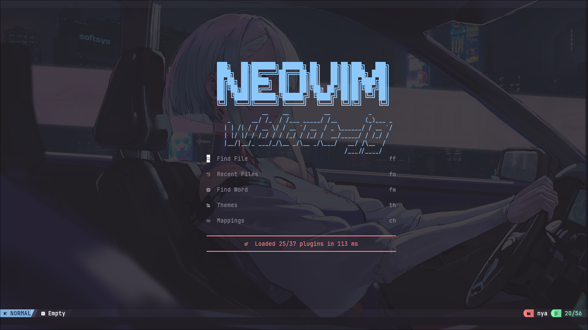
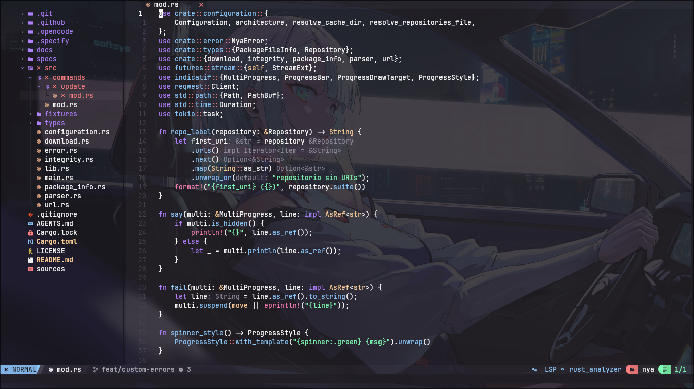
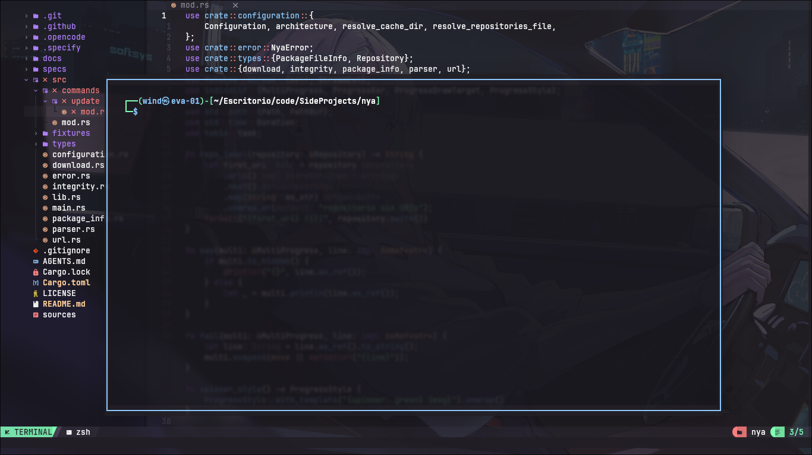
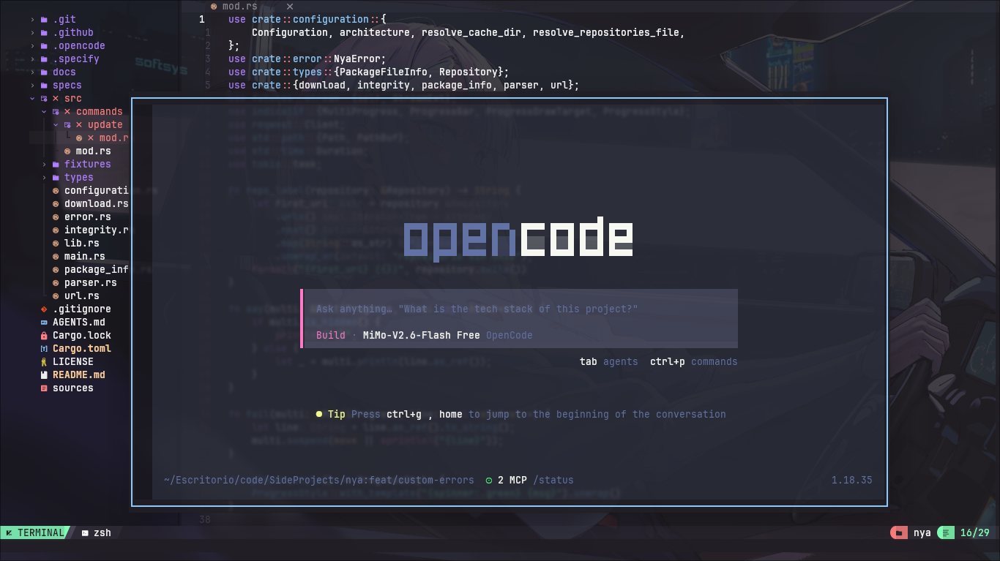
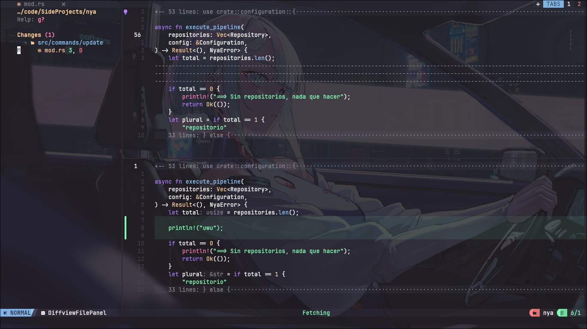
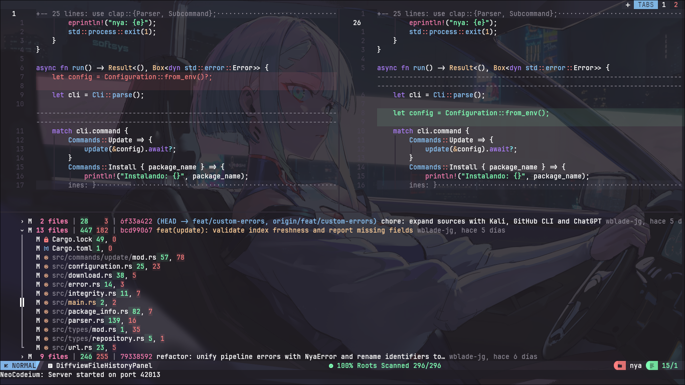

# nvim dots

Mis dots (configuraciones) de neovim. Basados en [NvChad](https://github.com/NvChad/NvChad), muy inspirados en [Kiro](https://kiro.dev) — hasta el tema de colores lo saqué de ahí.

Si te gustan, úsalos. si no, también está bien.

---

---

## Incluye

- **tema Kiro** — paleta de colores sacada del Kiro IDE de AWS. morados, cyans, verde menta
- **gestión de proyectos** con [project.nvim](https://github.com/DrKJeff16/project.nvim) — `<leader>fp` para alternar entre proyectos rápidamente
- **LSP** con nvim-lspconfig — Rust, C/C++, Python, TypeScript, HTML, CSS
- **formateo** con conform.nvim — stylua, rustfmt, ruff, prettierd, clang-format
- **AI inline** con [Codeium](https://codeium.com) — `<A-f>` para aceptar sugerencias
- **AI chat** con [CodeCompanion](https://github.com/olimorris/codecompanion.nvim) usando mimo-v2.5 vía opencode
- **diffs e historial Git** con diffview.nvim (`<leader>gd`, `<leader>gh`)
- terminal flotante centrada (75% × 70%)
- soporte para [Neovide](https://neovide.dev) con JetBrains Mono / FiraCode
